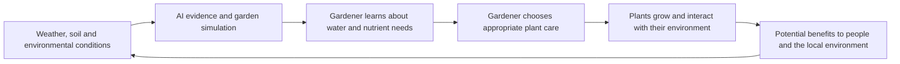

# GardenTwin 🌱

### AI-assisted garden care for a more climate-resilient future

**Built for the [2026 Veritas AI International High School Hackathon](https://highschoolhackathon.org/briefs) · Climate track**

GardenTwin brings AI environmental evidence, weather, soil information and a daily garden simulation into one website. It helps home gardeners and community gardens understand **when to water, how much water the model recommends, and what evidence is needed before applying fertilizer**.

The idea is a cycle: understand the environment, help people care for plants, support plant growth, and encourage the environmental benefits that healthy vegetation can provide. AI contributes atmospheric and satellite evidence; the digital twin translates weather, soil and crop assumptions into understandable daily estimates.

**The React frontend and FastAPI backend are both included.** Run them together locally or in GitHub Codespaces using the instructions below. The current implementation combines saved pretrained-model results, a process-based simulation and explicitly identified analytical fallbacks. Starting the website does not start fresh inference in every AI model.

## Contents

- [The problem and the Veritas connection](#the-problem-and-the-veritas-connection)
- [The garden–climate cycle](#the-gardenclimate-cycle)
- [What the program does](#what-the-program-does)
- [AI architecture and fallback behavior](#ai-architecture-and-fallback-behavior)
- [Run locally](#run-locally)
- [Run in GitHub Codespaces](#run-in-github-codespaces)
- [Use the website](#use-the-website)
- [How the code works](#how-the-code-works)
- [API reference](#api-reference)
- [Testing and evaluation](#testing-and-evaluation)
- [Development plan](#development-plan)
- [Project structure and credits](#project-structure-and-credits)

## The problem and the Veritas connection

A rainfall forecast alone cannot tell a gardener whether the root zone has enough water. Soil properties, temperature, crop development and recent conditions all matter. Fertilizer decisions need another piece of evidence: estimated crop demand does not reveal how much nitrogen, phosphorus or potassium is already in the soil.

GardenTwin connects those questions in a single workflow rather than asking users to interpret disconnected weather charts and soil values. The pilot is a tomato garden in Edison, New Jersey; the simulation also supports Pepper, Cucumber, Lettuce, Carrot, Bean and Strawberry.

For the Veritas Climate track, our focus is:

| Project goal | GardenTwin's approach |
| --- | --- |
| Apply AI to a climate-related problem | Explore pretrained atmospheric and Earth-observation models alongside a garden digital twin. |
| Help people make practical decisions | Explain daily watering needs, modeled stress and responsible nutrient next steps. |
| Make the work reproducible | Include the browser interface, API, source data references and startup instructions. |
| Evaluate and communicate honestly | Distinguish pretrained inference, saved outputs, analytical fallbacks and illustrative fixtures; separate software checks from scientific validation. |

Our contribution is the garden-focused workflow, simulation and decision explanations, integration of model evidence, and interactive interface. We use and credit existing pretrained models; we do not claim to have trained Aurora, Prithvi or FourCastNet from scratch. Veritas requires AI or machine learning to perform the main task and results to reflect actual work. The current separation between AI evidence and simulation recommendations is described below so readers can assess that integration accurately. See the official [submission requirements](https://highschoolhackathon.org/briefs) and [judging criteria](https://highschoolhackathon.org/judges).

## The garden–climate cycle

**Understand conditions → guide care → support plants → contribute to the environment → understand changing conditions again.**



GardenTwin helps the user learn what the modeled garden needs. The user can then choose watering and soil-informed fertilization practices. In turn, plants provide food and interact with the environment through growth, carbon uptake, shade and evapotranspiration. Thoughtful resource use can also help avoid unnecessary watering and excess fertilizer losses. These are the motivations behind the cycle; benefits depend on the crop, site and management. See the EPA's explanations of [vegetation and cooling](https://www.epa.gov/heatislands/using-trees-and-vegetation-reduce-heat-islands) and [nutrient management](https://www.epa.gov/nutrientpollution/sources-and-solutions-agriculture).

The diagram describes the environmental idea, not an automated control or learning loop. GardenTwin does not operate irrigation equipment, observe the user's actions through sensors, or retrain itself from plant outcomes. It does not currently calculate verified carbon sequestration, net emissions reductions, local cooling or field-measured water savings.

## What the program does

1. **Establish a garden location.** Create a browser-local profile and confirm an address or map pin. The coordinates are shared with Garden Setup.
2. **Configure a crop and season.** Choose a supported crop, planting date and simulation period. Basic setup uses automatic soil selection; Advanced setup exposes manual soil assumptions.
3. **Build the digital twin.** The backend retrieves historical weather, selects soil properties and models the season one day at a time.
4. **Explain plant care.** Review recommended irrigation depth, water stress, crop development and estimated nutrient demand. Missing soil-nutrient evidence remains unknown.
5. **Inspect AI evidence.** Request model status and analysis from Environment. Read each system's source, method, output, relevance and any loading errors.
6. **Explore alternatives and upcoming weather.** Compare rain-fed conditions with recommended irrigation, and request a current weather forecast. Future soil/crop projections require compatible dates.

### Five connected views

| View | What users can explore |
| --- | --- |
| **Overview** | Garden setup, a visual planting grid, selected-day calendar, watering and fertilizer assessments. |
| **Plant Growth** | Season playback, growth stages, accumulated warmth, estimated height and biomass. |
| **Soil & Water** | Root-zone water, soil thresholds, irrigation reasoning and a rain-fed versus irrigated comparison. |
| **Nutrients** | Estimated N/P/K demand, unavailable nutrient measurements and the need for a soil test. |
| **Environment** | Historical weather, current forecast, AI status and model-specific evidence. |

The grid is a planning interface; it is not a spatial multi-plant simulation. Profiles and grid settings are stored in the browser, not in an authenticated account. The Three.js plant specimen is an illustrative photographic plane with motion, not a scanned plant or measured growth reconstruction.

## AI architecture and fallback behavior

AI is the project's environmental intelligence layer. The current code uses previously generated pretrained-model outputs where available, then exposes their meaning and applicability alongside the simulation. Daily watering and crop calculations currently come from the simulation engine; the AI analysis route is separate and does not automatically feed those saved outputs back into each day's equations.

| System | Role | Current implementation |
| --- | --- | --- |
| **Microsoft Aurora Small** | Atmospheric/weather evidence | Loads a saved pretrained prediction generated from historical ERA5 input and summarizes regional temperatures. It is not a newly generated garden forecast for each request. |
| **NASA/IBM Prithvi-EO-2.0 300M** | Satellite-based environmental representation | Loads saved learned features from HLS observations. Features are not a trained crop-health classification or a soil test. |
| **NVIDIA Earth-2 / FourCastNet1** | Weather-model evidence | Loads a saved forecast produced through Earth2Studio with GFS input. The response identifies freshness and location relevance; total-column water vapor is not rainfall. |
| **AgriFM-E integration** | Agricultural assessment | Uses an explicitly labeled analytical fallback. A verified pretrained checkpoint/inference path is not implemented. |

`GET /ai/analyze/{run_id}` reports each system separately, including artifact errors and relevance. A saved result may be genuine model inference but still be outdated or unrelated to the selected garden and dates. `GET /ai/status` distinguishes configuration from artifact presence; its current `operational` count is 0, so file presence is not proof of a live running model.

### Why are there fallbacks and example data?

These are different mechanisms with different purposes:

| Mechanism | Reason it exists | What it means for the user |
| --- | --- | --- |
| **Analytical AI fallbacks** | Keep analysis available when a saved AI result is missing or cannot be loaded. | Calculations use the actual simulation's available weather, water and crop data, with a fallback method/status. They are not successful pretrained inference. |
| **Environmental-data fallbacks** | Handle some upstream data gaps or unavailable automatic soil lookup. | Available alternatives or manual assumptions are returned with provenance. Some failures still stop a request; the app cannot guarantee results without required inputs. |
| **Frontend example fixtures** | Let the interface open and illustrate its views before a successful backend run. | The current UI starts with a labeled example garden and illustrative comparison. These are not evidence about the user's garden and are not automatically substituted for a failed AI request. |

If an AI artifact fails, the simulation and supported analytical methods can still provide useful, explicitly qualified information. A backend error remains an error; an unknown fertilizer dose remains unknown. This preserves useful functionality without inventing a successful AI prediction.

The example UI is still present in the current source. **Analyze garden** replaces it only after a successful backend response; forecast and AI analysis are gated until then. Removing the initial example state and strengthening the AI-led workflow are separate application changes planned for another branch. This README update does not change that behavior.

### Running new model inference

Starting Uvicorn serves the API; it does not regenerate all model outputs. Utilities such as `aurora_real_inference.py`, `ai/run_prithvi.py` and `ai/test_earth2_inference.py` perform separate model workflows with their own dependencies, input data and hardware needs. The saved prediction/feature files are outputs, not the original model weights. Review configured locations and dates before regenerating them.

Installing the base API environment below does not guarantee all saved artifacts will deserialize. Aurora's saved Python objects can require the corresponding Aurora package; model workflows can require additional libraries and compatible versions. Use the model providers' installation instructions and inspect `artifact_errors` rather than treating a successful HTTP response as proof that every model loaded.

## Run locally

### Requirements

- Python **3.12**, the team's development version.
- Node.js **20.19+** or **22.12+**; a current compatible Node version is also suitable.
- **pnpm**, for the frontend's committed lockfile. If unavailable, install it with `npm install --global pnpm@10`.
- Internet access for dependency installation, weather, automatic soil lookup and address/map services.

The frontend dependency lockfile is included. The Python/model environment is not yet fully pinned, so the installation below is a base API environment rather than an exact reproduction of every inference environment.

### 1. Get the source

```bash
git clone https://github.com/Tsunami-The-Coder/GardenTwin.git
cd GardenTwin
```

For an existing checkout, use the current `main` branch containing both `frontend/` and `backend/`, and keep any uncommitted work before updating it.

### 2. Start the backend — terminal 1

From the repository root, create the environment once:

```bash
python3.12 -m venv .venvs/core
source .venvs/core/bin/activate
python -m pip install --upgrade pip
python -m pip install "fastapi[standard]" "pydantic>=2,<3" torch numpy pytest
```

On later visits, activate the existing environment with `source .venvs/core/bin/activate`; you do not need to reinstall packages each time.

Start the API and leave this terminal running:

```bash
python -m uvicorn backend.api.main:app --reload --host 127.0.0.1 --port 8000
```

On native Windows PowerShell, create the environment with `py -3.12 -m venv .venvs/core` and activate it with `.\.venvs\core\Scripts\Activate.ps1`. The `python -m pip` and Uvicorn commands are the same. WSL can use the Bash commands above.

### 3. Start the frontend — terminal 2

Open another terminal in the repository root:

```bash
cd frontend
pnpm install --frozen-lockfile
pnpm dev
```

Open **[http://127.0.0.1:5174/](http://127.0.0.1:5174/)**. Keep both terminals running. Use the same browser origin when returning because browser storage is separate for `localhost` and `127.0.0.1`.

Vite forwards `/api/*` to `http://127.0.0.1:8000/*` and strips `/api`. No frontend API URL edit or backend CORS change is needed for this workflow. This proxy belongs to the development server; a static production build needs its own API routing.

### 4. Check connectivity

From a third terminal:

```bash
curl --fail http://127.0.0.1:8000/health
curl --fail http://127.0.0.1:5174/api/health
```

Both should return `{"status":"running","application":"GardenTwin"}`. The second request checks the frontend-to-backend proxy. API documentation is at **[http://127.0.0.1:8000/docs](http://127.0.0.1:8000/docs)**. These checks verify connectivity, not weather access or model inference.

## Run in GitHub Codespaces

Codespaces is a remote development machine with VS Code in your browser. Both servers run inside the same Codespace; GitHub forwards the website's port to your browser. This is a development session, not an always-on deployment.

### 1. Open the repository

On GitHub, select **Code → Codespaces → Create codespace on main**. In the terminal, go to the checkout:

```bash
cd /workspaces/GardenTwin
```

If the checkout has a different folder name, use that path. Check that `frontend/` and `backend/` are both present. Use the Python and Node versions listed in [Requirements](#requirements); if `python3.12` is unavailable, select/install Python 3.12 before creating the environment.

### 2. Start the backend — terminal 1

Create/activate the Python environment and install packages using the local setup above. Then run:

```bash
python -m uvicorn backend.api.main:app --reload --host 0.0.0.0 --port 8000
```

### 3. Start the frontend — terminal 2

The committed Vite configuration permits a local hostname. In Codespaces, start Vite with a temporary runtime override for this Codespace's forwarded hostname. This command loads the existing configuration and API proxy without editing any repository files:

```bash
cd /workspaces/GardenTwin/frontend
pnpm install --frozen-lockfile
pnpm exec node --input-type=module <<'JS'
import { createServer } from 'vite';

const name = process.env.CODESPACE_NAME;
const domain = process.env.GITHUB_CODESPACES_PORT_FORWARDING_DOMAIN;
if (!name || !domain) throw new Error('Run this command inside GitHub Codespaces.');

const server = await createServer({
  server: {
    host: '0.0.0.0',
    port: 5174,
    strictPort: true,
    allowedHosts: [`${name}-5174.${domain}`],
  },
});
await server.listen();
server.printUrls();
JS
```

The hostname comes from [GitHub's Codespaces environment variables](https://docs.github.com/en/codespaces/developing-in-a-codespace/default-environment-variables-for-your-codespace). This invocation uses the project's installed Vite version; the existing `pnpm dev` wrapper does not forward command-line server options.

### 4. Open the website

1. Open the **PORTS** tab beside Terminal.
2. Find port **5174**, or add it with **Forward a Port**.
3. Keep visibility **Private** and select **Open in Browser**.
4. Use that forwarded URL, not your computer's `127.0.0.1:5174`.

The backend stays reachable through the frontend proxy inside the Codespace. You only need to forward port 8000 separately if you want to open its `/docs` page directly. The frontend's forwarded URL also supports `/api/health` and `/api/docs`. See [GitHub's port-forwarding guide](https://docs.github.com/en/codespaces/developing-in-a-codespace/forwarding-ports-in-your-codespace).

Keep both server terminals and the Codespace running while using the app. A Codespace does not itself supply a hosted AI endpoint or guarantee GPU acceleration; new model inference remains a separate workload.

## Use the website

1. Create your local profile and confirm the garden's address or map pin.
2. Select a crop, planting date and historical date range in Garden Setup. Choose a completed period for which the weather provider has data; runs support up to 366 inclusive days.
3. Select **Analyze garden** and wait for the backend response. The initial example label changes only after a successful run.
4. Use the calendar or Plant Growth timeline to inspect each simulated day.
5. Review daily irrigation amount/reason in Soil & Water. Select **Compare irrigation** for the fixed rain-fed versus recommended-irrigation scenario.
6. Read Nutrients for estimated uptake and evidence gaps. The current API does not accept nutrient soil-test values and therefore cannot supply a validated fertilizer product or dose.
7. In Environment, select **Check model status** and **Analyze simulation** under AI evidence & insights. Inspect the actual method and relevance for each model. Use **Get forecast** for current weather.

Forecasts only continue the crop/soil model when their first usable day immediately follows the run's last date. Otherwise, the response provides weather and a continuation note. Historical timeline records are not an upcoming forecast.

Backend runs are stored in process memory and disappear after a restart, including a Uvicorn reload. Browser profiles/grid settings can persist, but they do not preserve the backend run. Create a new simulation if a restored run returns 404.

## How the code works

```text
React interface
  → /api proxy in Vite
  → FastAPI validates location, crop, dates and soil settings
  → NASA POWER weather retrieval and automatic/manual soil selection
  → Daily soil-water, crop-growth and nutrient-demand simulation
  → Run records, irrigation reasoning and alerts
  → Charts, calendar and care guidance

Separate requests for a completed run
  → AI saved-artifact analysis with identified analytical fallbacks
  → Rain-fed versus recommended-irrigation comparison
  → Open-Meteo forecast and date-compatible model continuation
```

- **Water:** FAO-56 reference evapotranspiration and a root-zone bucket balance estimate water availability, drainage and stress. Advice is expressed as irrigation depth in mm; it is not automatically applied in the base run.
- **Growth:** crop-specific temperature thresholds accumulate growing degree days. Generalized profiles estimate stage, height and biomass; known water stress reduces new growth. These are modeled quantities, not measured yield or sensor-derived health.
- **Nutrients:** biomass gain supports illustrative N/P/K uptake estimates. Demand is not a fertilizer application rate. Without nutrient soil-test evidence, availability, nutrient stress and fertilizer dosage remain unknown; null is not zero.
- **Soil:** automatic mode tries USDA SSURGO and can fall back to manual assumptions with a note. Strict `ssurgo` mode requires a successful lookup. Mapped properties are not a laboratory test of an individual garden.
- **Forecast:** upcoming Open-Meteo weather is separate from the historical reconstruction and from saved AI artifacts.

Important input rules include `planting_date <= start_date <= end_date`, latitude −90…90, longitude −180…180, and `0 < crop_coefficient <= 2`. Manual volumetric thresholds must satisfy `0 <= wilting_point < field_capacity < saturation`; initial root-zone water must also respect the model's wilting and saturation bounds. See [the request schema](backend/schemas/simulation.py), [daily engine](simulation/engine.py) and [contracts](simulation/contracts.py).

## API reference

Paths below are backend routes. Browser requests through Vite add `/api` in front.

| Method | Route | Purpose |
| --- | --- | --- |
| GET | `/health` | Backend connectivity/status. |
| POST | `/simulation/run` | Create a garden simulation. |
| GET | `/simulation/{run_id}` | Retrieve the full run. |
| GET | `/simulation/{run_id}/overview?selected_date=YYYY-MM-DD` | Selected day plus seven following historical records; requires all eight records. |
| GET | `/simulation/{run_id}/intervention/irrigation` | Fixed rain-fed versus recommended-irrigation comparison, with no request body. |
| GET | `/simulation/{run_id}/forecast` | Current weather forecast and eligible model continuation. |
| GET | `/ai/status` | Configuration and saved-artifact availability. |
| GET | `/ai/analyze/{run_id}` | Model-specific evidence, relevance, fallbacks and errors. |

### Troubleshooting

| Symptom | What to check |
| --- | --- |
| `ModuleNotFoundError` | Activate the correct environment and run Uvicorn from the repository root. Artifact loading may need model-specific packages. |
| Website opens but analysis cannot connect | Keep both servers running. Check `/health` on 8000 and `/api/health` on 5174. |
| Codespaces reports a blocked host | Use the Codespaces startup command above, which allows the exact forwarded hostname. |
| Port already in use | Reuse the existing server or stop it with Ctrl+C in its terminal before restarting. Keep backend on 8000 because the proxy targets it. |
| HTTP 422 or 400 | Read the returned detail; check dates, input bounds, crop name and soil relationships. |
| HTTP 502 or upstream timeout | Check connectivity and weather/soil provider availability. Not all missing inputs can be replaced. |
| Run returns 404 | The backend may have restarted; create a new run. |
| AI returns a fallback or artifact error | Read the per-model status, dependency error and relevance. This does not mean a fresh pretrained prediction succeeded. |
| Fertilizer recommendation is unknown | Required nutrient soil-test evidence is unavailable; crop demand alone cannot establish an application dose. |

## Testing and evaluation

Run core backend tests from the repository root with the Python environment active:

```bash
python -m pytest tests -q
```

Run frontend checks from `frontend/` after installing its dependencies:

```bash
pnpm test
pnpm build
```

The frontend build type-checks the app and writes browser assets to `frontend/dist/client`. Optional Sites packaging is retained; `pnpm test:sites` checks that packaging when needed. A static build alone does not start the Python API. You can log in to http://127.0.0.1:5174/ to see the app.

The previous team verification record reported 150 passing backend tests, successful API runs for seven crops, and an AI response containing four system entries without artifact-loading errors in the tested environment. That is a team-reported execution record, not a fresh-install guarantee or evidence of four live models. Fresh verification is documented in [Results and evidence](#results-and-evidence) below; it covers an explicitly identified core subset and controlled simulation.

Software tests verify execution and contracts. They do not establish predictive accuracy, agronomic calibration or climate impact. Evaluation still needs held-out reference observations, forecast inputs restricted to information available at prediction time, and consistent comparisons of water use, stress and growth. Generalized crop profiles, missing nutrient evidence, saved-artifact relevance and model-environment reproducibility remain important limitations.

## Development plan

| Step | Scope |
| --- | --- |
| **Included now** | React interface, local profiles/grid, FastAPI routes, historical garden simulation, irrigation comparison, nutrient evidence states, forecast and model-specific AI evidence. |
| **Next application branch** | Remove the initial example UI state, define clear loading/error states, and make verified, garden-relevant inference more directly inform recommendations. These are planned changes, not behavior added by this README. |
| **Scientific improvement** | Add supported soil-test input and validated fertilizer guidance; calibrate crop profiles; test relevant predictions against held-out observations. |
| **Longer-term cycle** | Persist run history, support appropriate observations of plant response, and quantify environmental benefits using defensible measurements. |

The goal is for AI to play a central, verifiable role in the gardening decisions while preserving useful, clearly labeled behavior when an AI component is unavailable. Reliability should come from explicit methods and honest uncertainty, not fabricated model success.

## Project structure and credits

```text
GardenTwin/
├── frontend/                 # React/TypeScript website, assets and frontend tests
│   ├── src/                  # Five views, profile, layout, API adapters and fixtures
│   ├── public/               # Plant images, branding and asset notices
│   ├── tests/                # Frontend contracts, layout and profile checks
│   └── vite.config.mjs       # Port 5174 and /api proxy to port 8000
├── backend/
│   ├── api/                  # FastAPI routes
│   ├── schemas/              # Input validation
│   └── services/             # Simulation, soil, overview, comparison and forecast
├── simulation/               # Daily crop, water and nutrient models
├── ai/                       # Registry, artifact analysis and model utilities
├── data/                     # Saved inference outputs and supporting data
├── tests/                    # Backend/simulation checks
└── docs/                     # Project and submission documents
```

### Team

| Workstream | Contribution |
| --- | --- |
| Anuj | UI/UX, garden workflow and browser frontend. |
| Ayaan | Backend, environmental data, simulation and model pipelines. |
| Shared | Integration, testing, limitations and Veritas submission. |

### Models, data and software

| Resource | Use / source |
| --- | --- |
| [Microsoft Aurora](https://github.com/microsoft/aurora) | Pretrained atmospheric model; saved Aurora Small inference. |
| [NASA/IBM Prithvi-EO-2.0](https://github.com/NASA-IMPACT/Prithvi-EO-2.0) | Pretrained satellite feature extraction. |
| [NVIDIA Earth2Studio](https://github.com/NVIDIA/earth2studio) | FourCastNet1 weather inference workflow. |
| [NASA POWER](https://power.larc.nasa.gov/) | Historical weather. |
| [Open-Meteo](https://open-meteo.com/) | Forecast and applicable weather fallback. |
| [USDA SSURGO / Soil Data Access](https://sdmdataaccess.sc.egov.usda.gov/) | Mapped soil hydraulic properties. |
| [NASA/USGS HLS](https://hls.gsfc.nasa.gov/) | Satellite observations for Prithvi. |
| [ECMWF ERA5](https://www.ecmwf.int/en/forecasts/dataset/ecmwf-reanalysis-v5) | Atmospheric input for saved Aurora inference. |
| [NOAA GFS](https://www.emc.ncep.noaa.gov/emc/pages/numerical_forecast_systems/gfs.php) | Atmospheric input for FourCastNet1. |
| [Photon](https://photon.komoot.io/) and [OpenStreetMap](https://www.openstreetmap.org/copyright) | Address search and map context. |
| [FastAPI](https://fastapi.tiangolo.com/), [Pydantic](https://docs.pydantic.dev/) and [PyTorch](https://pytorch.org/) | Python API, validation and tensor/model tooling. |
| [React](https://react.dev/), [Vite](https://vite.dev/), [Three.js](https://threejs.org/), [Motion](https://motion.dev/), [Recharts](https://recharts.org/), [Leaflet](https://leafletjs.com/) and [Tabler](https://tabler.io/icons) | Browser interface, visualization, map and icons. |

AgriFM-E names an intended integration represented by an analytical fallback, not a verified pretrained model used here. Model, dataset and asset licenses remain with their respective providers. Preserve the notices in `frontend/public/garden/`; interface/component sources are recorded in [frontend/COMPONENT_SOURCES.md](frontend/COMPONENT_SOURCES.md), with additional acknowledgments in [credits.txt](credits.txt).

Development and design assistance includes [OpenAI ChatGPT/Codex](https://openai.com/codex/), OpenAI ImageGen, [Google Stitch](https://stitch.withgoogle.com/) and [Canva](https://www.canva.com/). AI-assisted development is distinct from the environmental-model inference used by GardenTwin and does not establish scientific validation.

**GardenTwin: learn what plants need, care for them thoughtfully, and explore how that care connects to the climate around us.**

## Results and evidence

Verification date: **November 15, 2026 (Eastern Time)**. The checks below used an unchanged temporary copy of source commit [`ed7d661`](https://github.com/Tsunami-The-Coder/GardenTwin/tree/ed7d66118a69cff72d70b202fedfe602e0dfacee). No backend, frontend, AI implementation or simulation equations were edited to obtain these results.

### 1. Fresh core software verification

**85 tests passed across 14 test modules, with 0 failures, 0 errors and 0 skips.** These checks were executed with Python **3.15.2** using the standard-library `unittest` runner. This is a selected core subset, not a rerun of the full pytest suite, browser integration or model inference. The recommended application environment remains Python 3.12.

```text
.....................................................................................
----------------------------------------------------------------------
Ran 85 tests in 0.008s

OK
```

The executed tests cover crop profiles, thermal time, daily simulation, season state progression, root-zone water balance, evapotranspiration, drainage, nutrient balance/leaching/losses, missing-data handling, overview date validation and mocked weather-provider responses. Evidence: [the tests at the checked commit](https://github.com/Tsunami-The-Coder/GardenTwin/tree/ed7d66118a69cff72d70b202fedfe602e0dfacee/tests). The timing is one local test run, not an inference-performance benchmark.

To run the same subset from the repository root:

```bash
PYTHONPATH=tests python -m unittest \
  test_crop_profiles test_daily_nutrients test_drainage test_engine \
  test_evapotranspiration test_gardenwin test_nasa_power \
  test_nutrient_balance test_nutrient_leaching test_season \
  test_soil_losses test_soil_properties test_thermal_time test_water_balance
```

### 2. Controlled garden simulation results

A separate execution of the existing season engine completed **all seven crops**, with **30 daily records per crop: 210 records total**. Crops: Bean, Carrot, Cucumber, Lettuce, Pepper, Strawberry and Tomato. Fertilizer status remained **unknown in all 210 records**, correctly retaining the absence of soil-test evidence.

**These are executed model outputs under synthetic, controlled inputs—not measured gardens, historical-weather retrievals or AI predictions.** The experiment called the existing [season engine](https://github.com/Tsunami-The-Coder/GardenTwin/blob/ed7d66118a69cff72d70b202fedfe602e0dfacee/simulation/season.py) and, for Tomato, the existing [irrigation comparison service](https://github.com/Tsunami-The-Coder/GardenTwin/blob/ed7d66118a69cff72d70b202fedfe602e0dfacee/backend/services/intervention_service.py). It did not use the frontend's example JSON.

| Controlled input | Value |
| --- | --- |
| Simulation dates / planting date | June 7–July 6, 2022 / May 1, 2022 |
| Site coordinates / elevation | 39.45, −75.23 / 0 m |
| Daily temperature, minimum / mean / maximum | 15 / 22 / 29 °C |
| Daily rainfall / relative humidity | 2 mm / 60% |
| Daily solar radiation / wind at 2 m | 20 MJ/m²/day / 2 m/s |
| Soil wilting point / field capacity / saturation | 0.12 / 0.30 / 0.45, volumetric fractions |
| Root depth / hydraulic conductivity | 30 cm / 10 mm/day |
| Initial root-zone water / crop coefficient | 90 mm, at field capacity / 1.0 |
| Irrigation efficiency / depletion fraction | 0.90 / 0.50 |
| Nutrient soil test | Unavailable |

The Tomato comparison used identical inputs and initial states. The intervention applied each rain-fed baseline day's recommended irrigation on that same day, exactly as implemented in the service.

| Output over 30 days | Rain-fed baseline | Fixed recommended-irrigation intervention |
| --- | ---: | ---: |
| Applied irrigation | 0.00 mm | 894.68 mm |
| Mean modeled water stress, 0–1 | 0.3274 | 0.0000 |
| Maximum modeled water stress, 0–1 | 0.6318 | 0.0000 |
| Days with modeled water stress | 20 | 0 |
| Final modeled biomass | 1,155.50 kg/ha | 1,971.80 kg/ha |
| Final crop health index | Unknown | Unknown |

The returned differences were **0.3274 less mean modeled water stress** and **816.30 kg/ha more modeled biomass**. They demonstrate the engine's response to water availability under its assumptions, not improved real-world yield or AI accuracy.

**The 894.68 mm irrigation total is an important limitation, not a watering recommendation or evidence of water savings.** The current comparison repeatedly uses recommendations from the rain-fed baseline rather than recalculating a schedule from the already-irrigated scenario. This experiment therefore does not establish efficient irrigation, an optimal schedule or field benefit. It identifies a concrete behavior to evaluate in future development.

### 3. Numerical evidence from the saved Earth-2 result

The committed [FourCastNet1/GFS output](https://github.com/Tsunami-The-Coder/GardenTwin/blob/ed7d66118a69cff72d70b202fedfe602e0dfacee/data/earth2_garden_forecast.json) contains these values:

| Saved output | Value |
| --- | --- |
| Model / input source | NVIDIA FourCastNet1 via Earth2Studio / GFS |
| Initialization | November 15, 2026, 00:00 UTC |
| Valid time / forecast lead | November 15, 2026, 06:00 UTC / 6 hours |
| Requested location | 39.4273, −75.2341 |
| Selected model grid point | 39.5, 284.75° east, equivalent to −75.25° |
| Predicted temperature | 6.1001 °C |
| Predicted wind speed at 10 m | 4.3837 m/s |
| Predicted mean sea-level pressure | 1,016.1530 hPa |
| Predicted total-column water vapor | 11.6976 kg/m² |

These numbers were read directly from the saved JSON; **fresh Earth-2 inference was not rerun during this verification**. Its valid time has passed, and its location is not the Edison pilot coordinate. It is historical model-output evidence, not a current garden forecast. Total-column water vapor is not rainfall. Without matching observations and original execution logs, the file alone does not establish predictive accuracy or independently verify how it was generated.

Saved [Aurora](https://github.com/Tsunami-The-Coder/GardenTwin/blob/ed7d66118a69cff72d70b202fedfe602e0dfacee/data/aurora_real_prediction.pt) and [Prithvi](https://github.com/Tsunami-The-Coder/GardenTwin/blob/ed7d66118a69cff72d70b202fedfe602e0dfacee/ai/data/prithvi/prithvi_features.pt) binary outputs also exist. They were not deserialized or regenerated in this check, so no new numerical inference claim is made for them. AgriFM-E remains an analytical fallback.

### What this evidence establishes

The fresh checks establish that the selected core tests pass and that the unchanged simulation can generate seven crop seasons, preserve unknown fertilizer information and respond to an irrigation intervention. The saved Earth-2 file supplies concrete atmospheric-model output for a recorded place and time.

They do **not** establish held-out AI accuracy, a calibrated fertilizer dose, optimized water use, measured plant-health improvement, carbon sequestration or verified climate impact. Those require relevant observations, independent evaluation and additional implementation. This distinction separates actual results from the project's intended environmental benefits.
