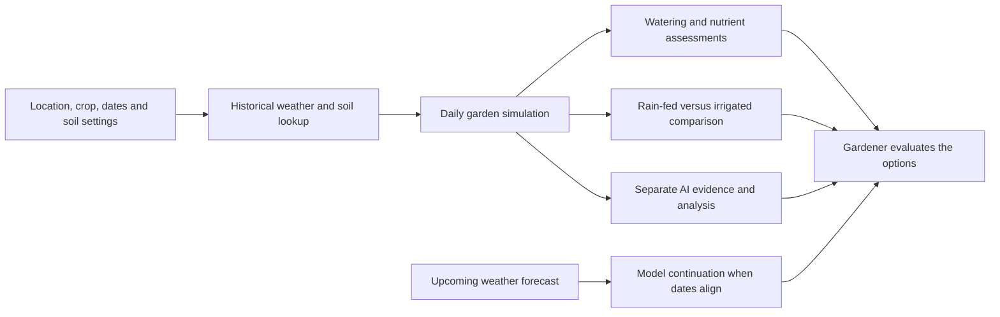

# GardenTwin 🌱

### Climate intelligence for everyday garden decisions

**Veritas AI Hackathon · AI + Climate · New Jersey, USA**

GardenTwin is a locally run garden digital twin that connects weather and soil information to two practical questions: **Should I water my garden, and what can I responsibly conclude about its fertilizer needs?**

Users configure a location, crop, planting date and soil settings. A daily simulation estimates root-zone water, crop development and nutrient demand, explains irrigation recommendations, and compares a rain-fed scenario with modeled irrigation. Separate AI analysis combines saved pretrained-model outputs with clearly identified analytical fallbacks.

**Current status:** a working local backend/API demo, with the browser frontend under development. The frontend setup and demo section below will be completed when that work is ready.

GardenTwin supports gardening decisions; it does not operate irrigation equipment or apply fertilizer automatically. Its outputs are modeled estimates, not measurements from a connected garden.

## Contents

- [Why GardenTwin](#why-gardentwin)
- [What the demo does](#what-the-demo-does)
- [Run locally](#run-locally)
- [Try a simulation](#try-a-simulation)
- [Frontend demo](#frontend-demo)
- [How the simulation works](#how-the-simulation-works)
- [AI architecture](#ai-architecture)
- [Environmental data](#environmental-data)
- [API reference](#api-reference)
- [Testing and evaluation](#testing-and-evaluation)
- [Limitations](#limitations)
- [Project structure](#project-structure)
- [Future development](#future-development)
- [Team and credits](#team-and-credits)

## Why GardenTwin

A weather forecast does not directly tell a gardener how much water a plant needs. The same rainfall can have different effects depending on the soil, root depth, crop and stage of development. Fertilizer decisions need a further distinction: estimated plant demand does not establish what nutrients are already available in the soil.

GardenTwin brings these variables together so users can explore a growing season, understand the reasoning behind a recommendation, and compare water use with modeled crop outcomes.

The pilot focuses on tomatoes in Edison, New Jersey. The simulation also supports six other garden crops.

### Prediction → decision → simulated outcome



The AI evidence layer is separate from the daily simulation. A saved model artifact is not automatically used as a new weather prediction for each run.

### Climate relevance

The project explores more informed water use, nutrient management and adaptation to changing weather. Plants also interact with the environment through biomass accumulation, shade and evapotranspiration. Those connections motivate the project; they are not measured impact results from this demo.

GardenTwin does **not** currently quantify verified carbon sequestration, net greenhouse-gas reductions, local cooling or field-measured water savings.

## What the demo does

| Capability | Current behavior |
| --- | --- |
| Garden simulation | Runs a date-aligned daily simulation for a location and supported crop. |
| Soil selection | Tries USDA SSURGO in automatic mode; supports manual inputs and strict SSURGO mode. |
| Weather | Retrieves historical daily weather and records its source, including applicable fallback/interpolation notes. |
| Crop development | Estimates growth stage, accumulated growing degree days, height and biomass. |
| Irrigation | Returns a daily status, recommended depth in mm and explanation. |
| Nutrients | Estimates daily N/P/K uptake; keeps unavailable soil-nutrient information unknown. |
| Irrigation comparison | Compares a rain-fed baseline with application of the baseline's daily recommended irrigation. |
| AI analysis | Reports saved inference outputs, analytical fallbacks, artifact relevance and loading errors separately. |
| Forecast | Retrieves up to seven usable days of forecast weather; continues soil/crop simulation only when dates align. |
| Browser frontend | In development; launch instructions and screenshots will be added below. |

The current comparison is a defined backend scenario. It is not an editor for arbitrary irrigation or fertilizer strategies.

## Run locally

The demo runs through a terminal. Internet access is required for weather retrieval and automatic soil lookup.

### 1. Clone the repository

```bash
git clone https://github.com/Tsunami-The-Coder/GardenTwin.git
cd GardenTwin
```

### 2. Prepare the Python environment

The team's development environment uses **Python 3.12**. If the tested environment already exists, activate it:

```bash
source .venvs/core/bin/activate
```

For a new environment on macOS, Linux or WSL:

```bash
python3.12 -m venv .venvs/core
source .venvs/core/bin/activate
python -m pip install --upgrade pip
python -m pip install "fastapi[standard]" "pydantic>=2,<3" torch pytest
```

These packages cover the main API imports and core test tooling. The repository does not yet include a pinned dependency file, so this is a starting environment rather than an exact reproduction of the team's model environment. Additional model-specific packages may be needed to deserialize saved artifacts or regenerate inference. Use the tested environment for the same model-loading behavior reported by the team.

See the official [FastAPI installation guidance](https://fastapi.tiangolo.com/tutorial/) and [PyTorch installation selector](https://pytorch.org/get-started/locally/) for platform-specific installation. Running new GPU inference is a separate workflow from serving the API with saved artifacts and analytical fallbacks.

On native Windows PowerShell, create and activate the environment with:

```powershell
py -3.12 -m venv .venvs/core
.\.venvs\core\Scripts\Activate.ps1
```

Then use the same `python -m pip` installation commands. The remaining shell examples use macOS/Linux/WSL syntax; Windows users can also submit requests through Swagger UI.

### 3. Start the backend

From the repository root, with the environment activated:

```bash
python -m uvicorn backend.api.main:app --reload --host 127.0.0.1 --port 8000
```

Keep this terminal open. In another terminal, check the server:

```bash
curl http://127.0.0.1:8000/health
```

Expected health response:

```json
{
  "status": "running",
  "application": "GardenTwin"
}
```

Open [interactive API documentation](http://127.0.0.1:8000/docs) to inspect routes and submit simulation requests. The machine-readable API description is at [openapi.json](http://127.0.0.1:8000/openapi.json).

No hosted deployment is required for this local demo. Run IDs are held in memory and are lost when the backend restarts, including a development-server reload.

## Try a simulation

Create `request.json` in the repository root with an example historical garden configuration:

```json
{
  "location_name": "Edison pilot garden",
  "latitude": 40.5187,
  "longitude": -74.4121,
  "crop_name": "Tomato",
  "planting_date": "2026-05-15",
  "start_date": "2026-05-15",
  "end_date": "2026-05-31",
  "crop_coefficient": 1.0,
  "soil_mode": "auto"
}
```

These are example inputs, not an assertion that a measured garden exists at those coordinates. The simulation retrieves weather for the specified location and period.

```bash
curl --fail-with-body --silent --show-error \
  -X POST http://127.0.0.1:8000/simulation/run \
  -H "Content-Type: application/json" \
  --data-binary @request.json > run.json

python -m json.tool run.json
```

The response contains `run_id`, site/crop/date metadata, soil provenance and a `records` array. Each record contains weather, soil water, nutrients, crop development, irrigation, fertilizer assessment and alerts for one simulation date.

With the same Python environment available in this terminal, retain the run ID:

```bash
GARDENTWIN_RUN_ID=$(python -c 'import json; print(json.load(open("run.json"))["run_id"])')
```

Then inspect the selected day, AI evidence, irrigation comparison and forecast:

```bash
curl --fail-with-body "http://127.0.0.1:8000/simulation/$GARDENTWIN_RUN_ID/overview?selected_date=2026-05-15"

curl --fail-with-body "http://127.0.0.1:8000/ai/status"

curl --fail-with-body "http://127.0.0.1:8000/ai/analyze/$GARDENTWIN_RUN_ID"

curl --fail-with-body "http://127.0.0.1:8000/simulation/$GARDENTWIN_RUN_ID/intervention/irrigation"

curl --fail-with-body "http://127.0.0.1:8000/simulation/$GARDENTWIN_RUN_ID/forecast"
```

The comparison route is **GET**, with no request body. The forecast for a historical run can return weather without future crop/soil guidance; check `simulation_continuation_available` and `continuation_note`.

### Input rules

- Latitude: −90 to 90; longitude: −180 to 180.
- Dates must satisfy `planting_date <= start_date <= end_date`.
- A run may span at most 366 inclusive calendar days.
- Crop coefficient must be greater than 0 and no greater than 2; default 1.0.
- Soil modes: `auto`, `ssurgo` or `manual`.
- Soil thresholds must satisfy `0 <= wilting_point < field_capacity < saturation`.
- Initial water content cannot exceed the request's soil saturation.

Optional manual/fallback defaults are `wilting_point=0.12`, `field_capacity=0.30`, `saturation=0.45`, hydraulic conductivity `10 mm/day` and root depth `30 cm`. Initial water content defaults to the selected profile's field capacity.

Automatic mode tries SSURGO and falls back to manual assumptions when necessary, with a provenance note. Strict `ssurgo` mode requires a successful lookup. Manual mode avoids the soil lookup but still requires historical weather access.

## Frontend demo

**In development — replace this section when the frontend is ready.**

<!-- FRONTEND HANDOFF: Add the committed frontend path, Node version, exact install/start/build commands, backend connection setting, screenshots and tested end-to-end flow. Do not claim integration until it has been tested. -->

| Item | To be added |
| --- | --- |
| Frontend directory / branch | TODO |
| Requirements | TODO |
| Install and start commands | TODO |
| Backend URL configuration | TODO |
| Demo screenshots or video | TODO |
| Tested frontend-to-backend workflow | TODO |

The interface is organized around five modules:

| Module | Purpose |
| --- | --- |
| Overview | Garden setup, daily watering and fertilizer assessments, garden summary and care guidance. |
| Plant Growth | Explore crop development and the selected simulation date. |
| Soil & Water | Inspect root-zone water, modeled stress and irrigation reasoning. |
| Nutrients | Explain nutrient demand, available evidence and fertilizer-assessment limitations. |
| Environment | Inspect weather, data sources and applicable forecast information. |

Until frontend source and startup instructions are committed, a fresh clone provides the backend/API demo rather than the completed browser experience.

## How the simulation works

### Crop development

Seven crop profiles are supported:

| Crop | Example accepted names |
| --- | --- |
| Tomato | `Tomato`, `tomatoes` |
| Pepper | `Pepper`, `Bell pepper` |
| Cucumber | `Cucumber` |
| Lettuce | `Lettuce` |
| Carrot | `Carrot` |
| Bean | `Bean`, `Green bean` |
| Strawberry | `Strawberry` |

Each profile defines base/upper temperatures, growing degree-day thresholds and illustrative height/biomass parameters. Accumulated thermal time determines development through planted, emergence, vegetative, flowering, fruit development and maturity stages. Known environmental stress affects modeled growth.

These generalized profiles are not a claim of crop-specific scientific calibration. Estimated yield and health can be unavailable; missing values must not be interpreted as zero.

### Soil water and irrigation

The model tracks water in the crop root zone using weather inputs, evapotranspiration, soil hydraulic properties and any irrigation supplied by a scenario. It returns a modeled water-stress index, recommended irrigation depth and explanation.

Root-zone water is expressed in **mm**, root depth in **cm**, and water stress as a **0–1 modeled index**. These are not readings from a physical moisture sensor or a measured plant-health score.

### Nutrients and fertilization

Daily nitrogen, phosphorus and potassium demand is estimated from modeled biomass gain using illustrative assumptions. This describes estimated crop uptake, **not a fertilizer product dose**.

The current simulation-creation route does not accept nutrient soil-test measurements. Without those data, nutrient availability and stress remain unknown, and the appropriate fertilizer assessment is `unknown`. GardenTwin does not manufacture zero nutrient levels or a validated application rate.

### Irrigation comparison

Both scenarios use the same weather, soil, crop settings and initial conditions:

- **Baseline:** rain-fed simulation.
- **Intervention:** apply each baseline day's recommended irrigation on that corresponding day.

The response summarizes irrigation totals, average/maximum water stress, stressed-day count and final biomass, with differences and limitations. It currently does not return daily comparison series or accept user-defined strategy parameters. A biomass change is a simulated outcome, not proof of measured productivity gains or water savings.

### Seven-day forecast

The forecast route retrieves Open-Meteo weather. Crop/soil continuation is available only when the first usable forecast day immediately follows the last simulated day. Otherwise, weather is returned with an explanation and no projected crop/soil records.

The Overview endpoint's `next_7_days` are existing historical-simulation records. They are distinct from the upcoming weather forecast. Overview requires the selected day and seven consecutive following records, so dates near the end of a run may not have a complete overview.

## AI architecture

| System | Purpose | Current implementation and boundary |
| --- | --- | --- |
| Microsoft Aurora Small | Atmospheric/weather evidence | Saved pretrained inference from historical ERA5 input; regional temperature statistics, not a fresh calibrated garden forecast. |
| NASA/IBM Prithvi-EO-2.0 300M | Satellite feature extraction | Saved learned features from HLS observations; not a trained crop-health classification or soil test. |
| AgriFM-E | Agricultural assessment | Analytical fallback over available simulation information; verified pretrained inference is not implemented. |
| NVIDIA Earth-2 / FourCastNet1 | Atmospheric-model evidence | Saved FourCastNet1 inference through Earth2Studio using GFS input; freshness and spatial relevance must be checked. |

The analysis route attempts to load the available saved artifacts and falls back to analytical methods when loading fails. Its response identifies each system's method, status, input source, outputs, relevance information, artifact errors and limitations. Total-column water vapor from Earth-2 is not rainfall.

`GET /ai/status` distinguishes configuration from artifact presence. Neither proves a model is operational. The current registry reports no verified live operational models; it must not be presented as four continuously running garden models.

### Optional artifact regeneration

Regenerating model artifacts is separate from starting the API. It may require model packages, data access, suitable hardware and the corresponding model licenses.

Repository utilities include `aurora_real_inference.py`, `ai/discover_hls.py`, `ai/download_hls.py`, `ai/run_prithvi.py` and `ai/test_earth2_inference.py`. Review their dependencies and configured data periods before running them.

The HLS discovery/download utilities read coordinates from environment variables:

```bash
export GARDENTWIN_LATITUDE="40.5187"
export GARDENTWIN_LONGITUDE="-74.4121"
```

Those variables configure the HLS utilities. Ordinary garden simulations use the coordinates in the API request.

## Environmental data

| Source | Role |
| --- | --- |
| [NASA POWER](https://power.larc.nasa.gov/) | Historical daily weather inputs. |
| [Open-Meteo](https://open-meteo.com/) | Applicable weather fallback and upcoming forecast data. |
| [USDA SSURGO / Soil Data Access](https://sdmdataaccess.sc.egov.usda.gov/) | Mapped soil hydraulic properties for the selected coordinates. |
| [NASA/USGS Harmonized Landsat Sentinel](https://hls.gsfc.nasa.gov/) | Satellite imagery used for Prithvi features. |
| [ERA5](https://www.ecmwf.int/en/forecasts/dataset/ecmwf-reanalysis-v5) | Historical atmospheric input for the saved Aurora result. |
| [GFS](https://www.emc.ncep.noaa.gov/emc/pages/numerical_forecast_systems/gfs.php) | Atmospheric input for the saved FourCastNet1 result. |

SSURGO represents mapped soil areas, not a laboratory test of an individual garden. Weather products and satellite features likewise have spatial/temporal resolution limits. Preserve returned provenance and applicability notes instead of presenting every value as a direct garden measurement.

## API reference

| Method | Endpoint | Purpose |
| --- | --- | --- |
| GET | `/health` | Backend status. |
| POST | `/simulation/run` | Create a simulation. |
| GET | `/simulation/{run_id}` | Retrieve the full run. |
| GET | `/simulation/{run_id}/overview?selected_date=YYYY-MM-DD` | Selected day plus the following seven simulation records. |
| GET | `/ai/status` | Model configuration/artifact status. |
| GET | `/ai/analyze/{run_id}` | Saved-artifact and fallback analysis. |
| GET | `/simulation/{run_id}/intervention/irrigation` | Rain-fed versus recommended-irrigation comparison. |
| GET | `/simulation/{run_id}/forecast` | Upcoming weather and eligible simulation continuation. |

Request validation is defined in [backend/schemas/simulation.py](backend/schemas/simulation.py). Daily record contracts are in [simulation/contracts.py](simulation/contracts.py); route behavior is in [backend/api/main.py](backend/api/main.py).

The backend allows local frontend origins on ports 3000 and 5173 for both `localhost` and `127.0.0.1`.

### Troubleshooting

| Symptom | What to check |
| --- | --- |
| `ModuleNotFoundError` | Activate the intended environment and run from the repository root. Saved artifacts can require additional model-specific packages. |
| HTTP 422 | Check required fields, ISO dates, crop names and numeric bounds. |
| HTTP 400 | Read `detail`; possible causes include invalid date/soil relationships, missing weather fields or incomplete Overview dates. |
| HTTP 404 for a run | The backend may have restarted. Create a new run and use its new ID. |
| HTTP 502 | An upstream weather/soil/forecast request failed. Check connectivity and returned details; automatic soil mode can fall back to manual assumptions, while strict SSURGO cannot. |
| AI `artifact_errors` | Inspect the model-specific error and status. The analysis may still return an explicit fallback. |
| Forecast has no crop projections | Inspect `simulation_continuation_available` and `continuation_note`; a historical run usually cannot be continued directly into today's forecast. |

## Testing and evaluation

Run the core automated test directory from the repository root:

```bash
python -m pytest tests -q
```

Model-generation and inference scripts are separate from this core test command.

### Team-reported local verification

The latest results supplied by the team are:

- **150 automated tests passed.**
- Backend health request succeeded.
- All seven supported crops completed simulation requests with HTTP 200.
- AI analysis returned results for all four system integrations.
- The tested analysis response reported no artifact-loading errors.

These are results from the team's local environment, not a claim that the README's fresh-install instructions were rerun or that a public CI job reproduced them. Add the tested commit, environment versions and logs when publishing a reproducible results record.

### Scientific validation

Passing software tests demonstrates execution and contract behavior, not predictive accuracy. The team's November 8–14, 2026 crop runs were functional API checks, not a completed unseen-period predictive evaluation.

A formal evaluation still needs:

1. A documented development cutoff and untouched later test period.
2. Forecast inputs restricted to information available at prediction time.
3. Reference weather, soil-moisture and crop observations where available.
4. Reported prediction errors and comparisons of resource use/stress/biomass under consistent conditions.

Historical weather reconstruction is not, by itself, a forecast-validation experiment. No held-out predictive-accuracy result or measured climate-impact benefit is claimed here.

## Limitations

- **Illustrative crop parameters:** profiles and generalized growth curves need crop-specific calibration and field validation.
- **Unknown nutrients:** missing soil-test information is not zero nutrient availability; current nutrient demand is not a validated fertilizer dosage.
- **Unavailable outputs:** health and yield fields may be null and should be displayed as unavailable.
- **Mixed AI methods:** saved inference artifacts and analytical fallbacks are not live inference for every run.
- **Satellite interpretation:** Prithvi features are not a direct plant-health classification or backyard soil measurement.
- **Forecast applicability:** stale or spatially mismatched artifacts are not upcoming garden forecasts; model continuation is conditional.
- **Scenario scope:** irrigation comparison uses a specific same-day recommendation schedule and omits equipment, water-availability and cost constraints.
- **No measured climate impact:** carbon, emissions, cooling and verified resource savings are not quantified.
- **Temporary storage:** runs are held in memory, with no persistent garden history.
- **Reproducibility and integration:** dependency pinning, the frontend handoff and documented end-to-end browser verification remain to be completed.

## Project structure

```text
GardenTwin/
├── backend/
│   ├── api/                  # FastAPI routes
│   ├── schemas/              # Request validation
│   └── services/             # Run, overview, soil, intervention and forecast services
├── simulation/
│   ├── contracts.py          # Shared run and daily record structures
│   ├── engine.py             # Daily model step
│   ├── season.py             # Season execution
│   ├── crops/                # Crop profiles, thermal time and growth
│   ├── water/                # Root-zone water and irrigation calculations
│   ├── nutrients/            # Nutrient balance, demand and losses
│   └── weather/              # Historical weather retrieval
├── ai/                       # Model registry, artifact loading and analysis
├── data/                     # Saved inference outputs and supporting data
├── frontend/                 # Frontend handoff placeholder
├── tests/                    # Automated core tests
└── docs/                     # Project and submission documentation
```

Some original setup documents describe the project's earlier starting state. The implemented API and current source contracts take precedence over those older placeholders.

## Future development

- Complete and integrate the browser frontend, with documented local startup and demo media.
- Commit a tested, pinned dependency environment and repeatable verification record.
- Improve crop-specific calibration and evaluate against held-out observations.
- Add supported soil-test input and agronomically validated nutrient guidance.
- Expand configurable scenario comparison and daily comparison outputs.
- Add verified, relevant model inference and stronger satellite interpretation.
- Persist garden configurations and run history.
- Quantify environmental trade-offs only when defensible methods and reference data are available.

## Team and credits

| Workstream | Responsibility |
| --- | --- |
| UI/UX and frontend | Anuj — product flow, visual design and browser interface. |
| Backend, simulation and local AI | Ayaan — API, environmental data, simulation and model pipelines. |
| Integration and evaluation | Shared — contracts, demo verification, limitations and submission. |

Built with Python, FastAPI, Pydantic and PyTorch. The frontend stack and final run instructions will be recorded with its handoff.

Model and data credits include Microsoft Aurora, NASA/IBM Prithvi-EO-2.0, NASA/USGS HLS, NVIDIA Earth2Studio/FourCastNet1, NASA POWER, Open-Meteo, USDA SSURGO, ECMWF ERA5 and NOAA GFS. AgriFM-E is represented by an explicitly labeled analytical fallback. Model and dataset licenses remain with their respective providers.

Development/design assistance includes OpenAI ChatGPT/Codex, OpenAI ImageGen, Google Stitch and Canva. The local UI work uses Tabler icons under its MIT license; preserve the relevant asset notices when the frontend is committed. AI assistance does not establish scientific validation of the resulting model or recommendations.

**Repository:** [Tsunami-The-Coder/GardenTwin](https://github.com/Tsunami-The-Coder/GardenTwin)  
**Challenge:** Veritas AI Hackathon, AI + Climate  
**Pilot:** Edison, New Jersey

*GardenTwin — understand the conditions, compare the choices, and grow with care.*
